# 小日子 v2 · 记录每一个重要的日子

安卓手机用的**离线**纪念日 App：任意日子倒数/正数、生日（公历/农历）、恋爱纪念日、桌面小组件、分享卡片。

参考了市面上做得最好的几款同类产品（[倒数日 Days Matter](https://apps.apple.com/cn/app/%E5%80%92%E6%95%B0%E6%97%A5-days-matter/id406170251)、[恋爱纪念日](https://apps.apple.com/cn/app/%E6%81%8B%E7%88%B1%E7%BA%AA%E5%BF%B5%E6%97%A5-%E8%AE%B0%E5%BD%95%E6%81%8B%E7%88%B1%E5%A4%A9%E6%95%B0-%E5%80%92%E8%AE%A1%E6%97%B6%E8%BD%AF%E4%BB%B6/id1542797267)、[Countdown Buddy](https://sspai.com/post/83729)）的核心能力，并把它们做成了完全离线、无广告、无会员的版本。

## 直接安装

把 `xiaorizi-1.0.apk` 传到 vivo 手机安装即可（允许"未知来源"）。详细步骤、Vivo 省电设置见 [使用说明.md](使用说明.md)。

## 界面预览

| 首页 | 日历 | 深色模式 |
| --- | --- | --- |
| 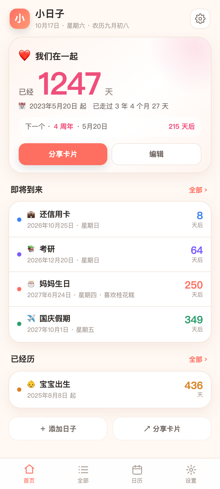 | 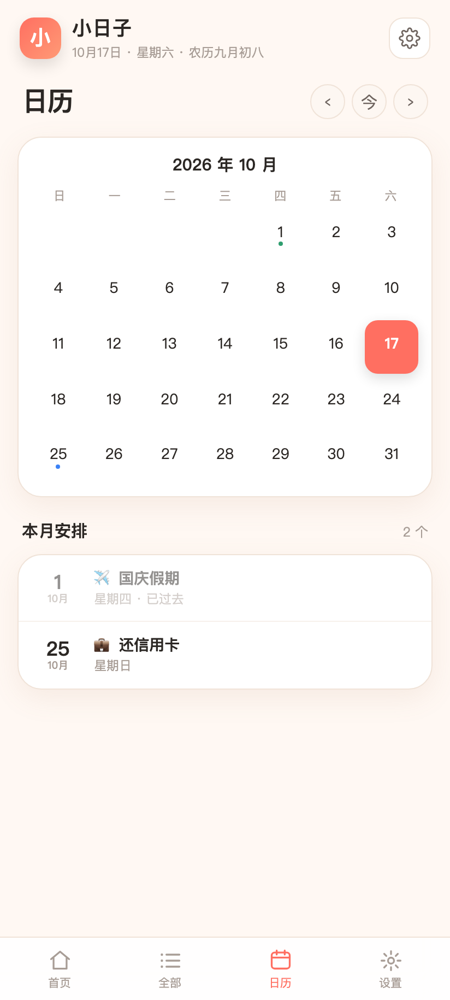 | 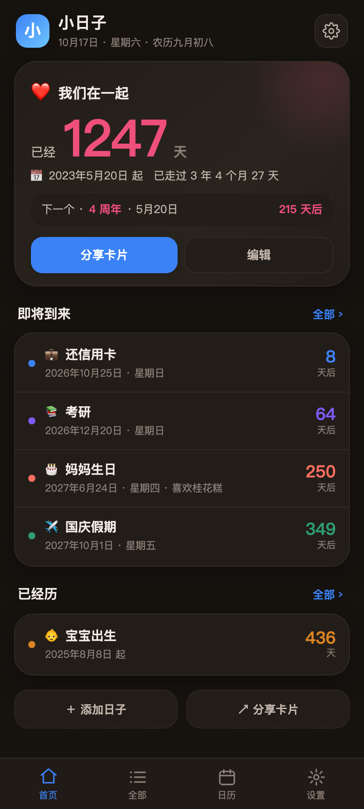 |

| 编辑日子（滚轮选日期） | 自定义背景图 | 桌面小组件 |
| --- | --- | --- |
| 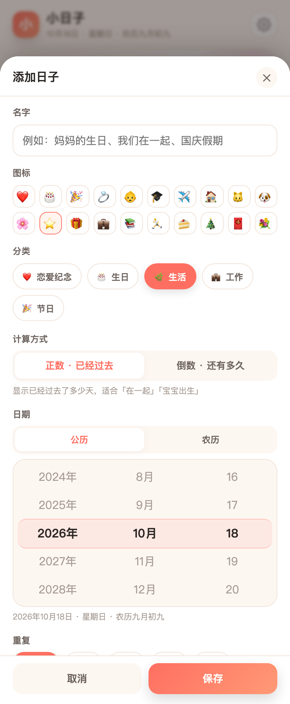 | 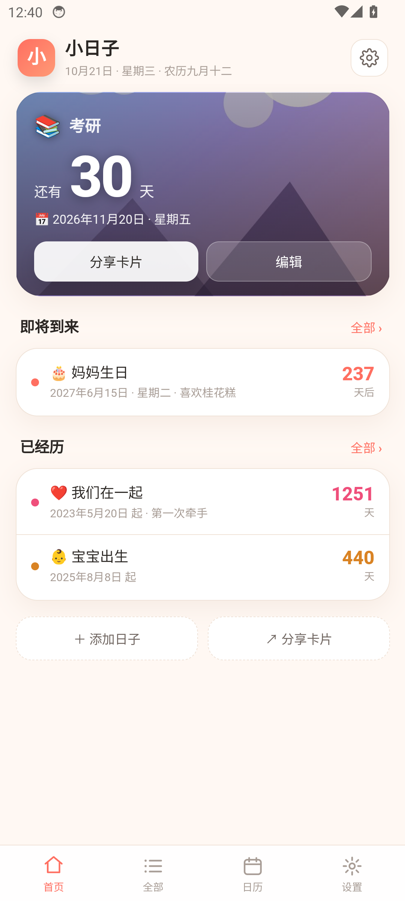 | 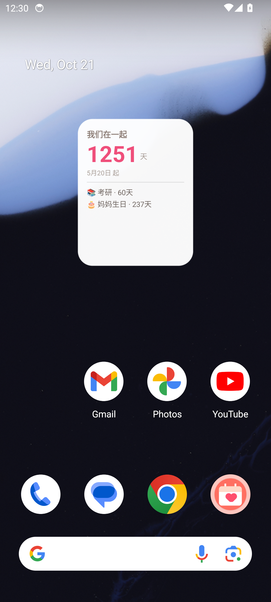 |

**恋爱里程碑**（520 / 1314 / 999 / 周年 自动倒计时）：

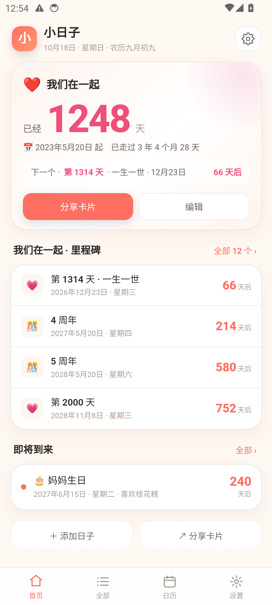

| 分享卡片 | 选背景图 | 深色模式 |
| --- | --- | --- |
| 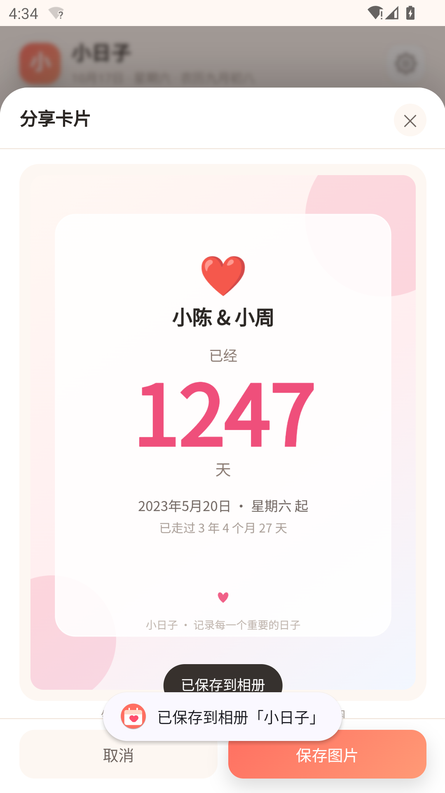 | 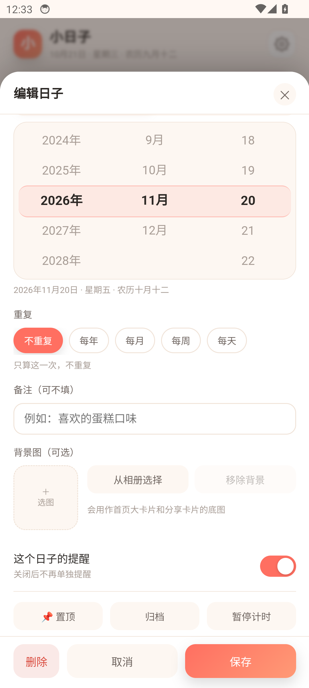 |  |

## v2 相比 v1 的改进

| 能力 | v1 | v2 |
| --- | --- | --- |
| 任意日子倒数/正数 | 只有生日和恋爱 | ✅ 任意事件，可正向可倒数 |
| 重复周期 | 只有生日逐年 | ✅ 不重复 / 每年 / 每月 / 每周 / 每天 |
| **桌面小组件** | ❌ | ✅ 原生 AppWidget，2×2 / 4×2 |
| 日历视图 | ❌ | ✅ 月历 + 本月安排 |
| 分享卡片 | ❌ | ✅ Canvas 生成图片，保存到相册 |
| 深色模式 | ❌ | ✅ 跟随系统 / 浅色 / 深色 |
| 主题色 | ❌ | ✅ 6 种，全局生效 |
| 分类 / 搜索 | ❌ | ✅ 5 个分类 + 关键词搜索 |
| 置顶 / 归档 / 暂停 | ❌ | ✅ 都支持（v2.4：可多置顶，最近置顶的排第一） |
| 每事件独立提醒 | ❌ | ✅ 可单独关掉某个日子 |
| 图标 | 无 | ✅ 20 个 emoji 可选 |

## 功能清单

- **任意日子**：生日、恋爱纪念日、结婚纪念、假期、考试、还款日……正数（已经过去多少天）或倒数（还有多少天）
- **农历**：支持农历生日与农历纪念日，含闰月；每年自动换算公历，遇平年无闰月自动按平月
- **边界处理**：2 月 29 日、每月 31 号在短月份自动回退
- **生日专属**：自动显示满几岁、星座、对应公历/农历
- **里程碑**：正数事件自动显示下一个周年与百天/520/1314 等节点
- **提醒**：本地通知，可选当天/提前 1·3·7 天，自定义时间；每天每周重复的事件自动限量，避免刷屏
- **备份**：导出/导入 JSON，换手机不丢数据
- **完全离线**：无网络权限、无广告、无账号、无会员

## v2.4 更新（本次）

| 变更 | 说明 |
| --- | --- |
| 📌 **置顶改为「最近置顶优先」** | 旧版多个置顶之间只按天数排，新置顶的条目经常排不到第一，看起来像“置顶改了没反应”；现在按置顶时间戳排序，最后置顶的稳居第一 |
| 🎯 **明确「唯一主卡片」** | 首页大卡片 = 最近置顶（没有置顶则取最近的日子），其余置顶在新增的「其他置顶」分组里 |
| 👆 **列表行内置顶按钮** | 「全部」和「其他置顶」每行右侧有 📌，点一下立即置顶/取消，不用进编辑页 |
| 🔝 **置顶开关移到编辑页顶部** | 旧版埋在弹层最底部，需要滑过所有字段才能找到，容易被当成“改不了” |
| 🔄 **立即生效** | 置顶/取消后马上重排并刷新桌面小组件，不再等下次打开 |
| 🧩 **老数据无损** | 升级后原有置顶保持不变，仍是置顶；只是首次重新点置顶时才产生新的排序时间 |
| ♻️ **编辑不打乱顺序** | 只改名字/日期不会改变置顶顺序；取消后重新置顶才排到第一 |

| 编辑页顶部置顶开关 | 首页多置顶分组 |
| --- | --- |
| 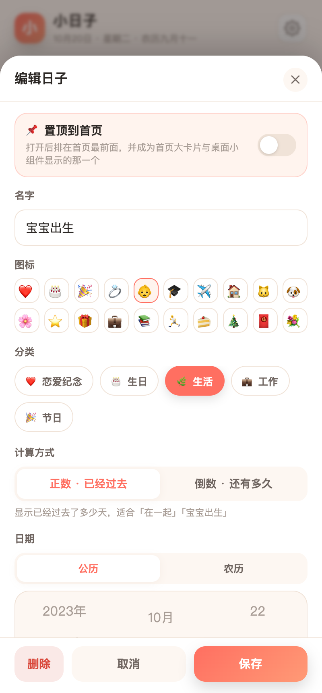 | 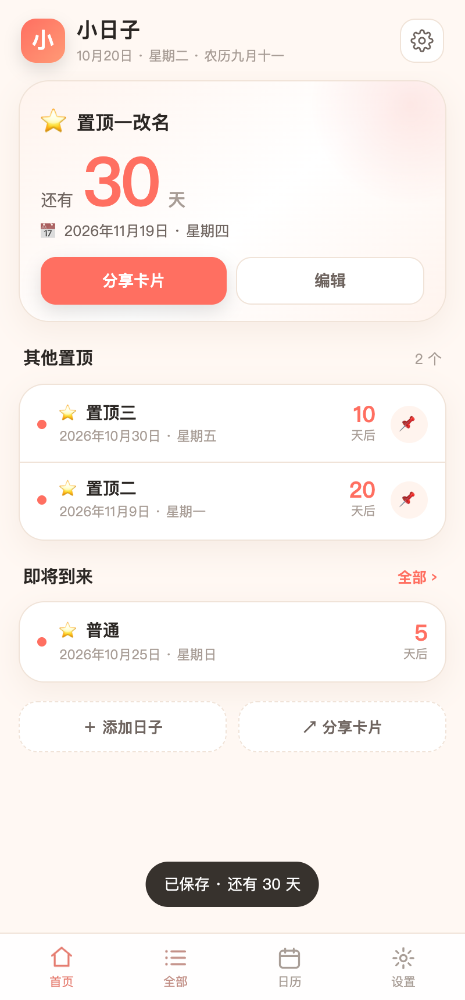 |

## v2.3 更新

| 变更 | 说明 |
| --- | --- |
| 🖼 **小组件支持背景图** | 首页大卡片用了自定义背景图时，小组件自动同步同一张图（等比裁切、偏上对齐） |
| 🎨 **小组件重新设计** | 从纯白卡片改为**彩色渐变底 + 白色文字**，跟随 App 主题色；深色模式自动加深 |
| ✨ **渐变有层次** | 右上柔光 + 左下暗角 + 斜向高光，不再是单调纯色 |
| 📐 **排版更紧凑** | 大数字放大到 42sp，“即将到来”两行贴底显示，4×2 尺寸不再留大片空白 |

| 封面背景版 | 主题色渐变版 |
| --- | --- |
| 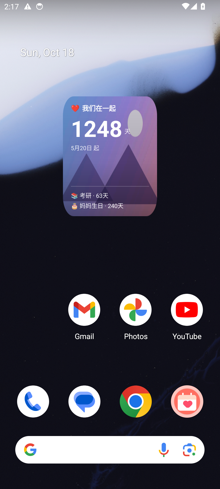 | 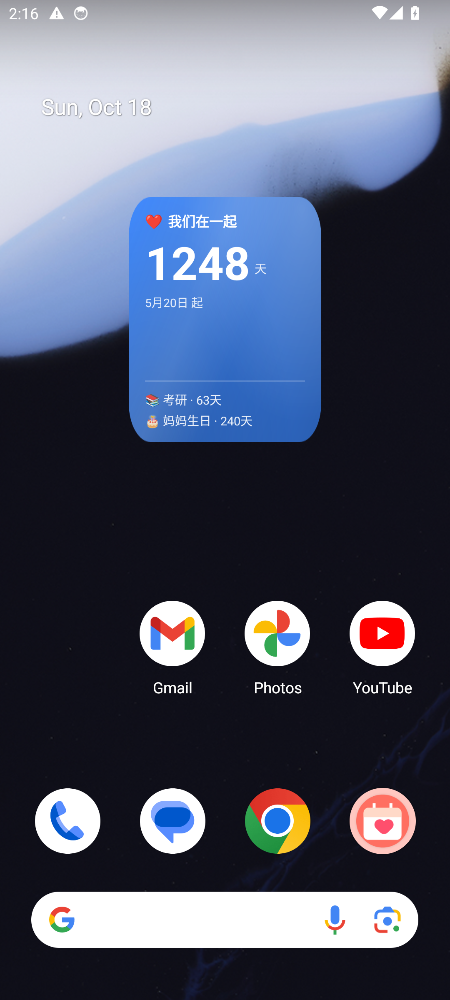 |

## v2.2 更新

| 变更 | 说明 |
| --- | --- |
| 🗑 **移除「生成示例数据」** | 设置页只保留导出 / 导入 / 清空；欢迎页也不再提供示例入口 |
| ❤️ **恋爱里程碑自动生成** | 恋爱纪念日自动算出 520 / 999 / 1314 / 3344 / 周年 等日子，显示**具体日期 + 还有多少天**，并自动排提醒 |
| 🔔 **里程碑提醒** | 有含义的日子（520/1314/周年）按你设置的提前天数提醒；普通整百天只在当天提醒，不打扰 |
| 🔀 **可开关** | 编辑页新增「显示里程碑倒计时」开关，不需要可以关掉 |
| 📋 **全部里程碑** | 首页卡片点「全部 N 个」可查看完整列表（含 100 周年） |

## v2.1 更新

| 修复 / 新增 | 说明 |
| --- | --- |
| 🐞 **小组件天数不更新** | 改为原生按「今天」重算，不再依赖网页算好的文本；每天 0:05 自动刷新，系统日期/时区变化、解锁时也刷新 |
| 🎡 **日期选择器换新** | 原来的下拉框换成滚轮（惯性滚动 + 吸附 + 中间高亮），农历闰月同样支持 |
| 🖼 **自定义背景图** | 每个日子可从相册选图，用于首页大卡片与分享卡片，自动压缩、可移除 |
| 🌙 小组件配色 | 跟随 App 深浅色自动切换 |

## 安装包校验

- 文件：`xiaorizi-1.0.apk`
- 版本：v2.4（versionCode 1，可直接覆盖安装，数据保留）
- 大小：约 578 KB
- SHA-256：构建后见 `build/SHA256.txt`
- 签名：v1 + v2 + v3 全通过（`apksigner verify` 可复验）
- 注：每次重新构建（`./build.sh`）zip 时间戳不同，SHA-256 会随之变化，属正常现象。

## 项目结构

```
app/src/main/                     源码
├── java/com/xiaorizi/birthday/   原生：WebView 外壳、通知、小组件、备份、相册保存
├── assets/www/                   界面：index.html / style.css / app.js / logic.js / lunar.js
└── res/                          图标、主题、小组件布局
build.sh                          一键构建（aapt2 → javac → d8 → zipalign → apksigner）
resign/xiaorizi.keystore          签名密钥，请勿删除
docs/screenshots/                 界面截图
使用说明.md                        安装与使用文档
```

## 构建

需要 JDK 17、Android SDK（platforms;android-34、build-tools;34.0.0）：

```bash
export JAVA_HOME=/path/to/jdk-17
export ANDROID_SDK_ROOT=/path/to/android-sdk
./build.sh
```

## 技术

- 包名 `com.xiaorizi.birthday`，minSdk 23 / targetSdk 34
- 界面：原生 WebView + HTML/CSS/JS（离线加载 `file:///android_asset/www/index.html`）
- 小组件：`AppWidgetProvider` + `RemoteViews`，网页推送数据后刷新
- 提醒：AlarmManager 精确闹钟 + 通知渠道；开机 / 覆装后自动重排
- 农历：内置 [lunar-javascript](https://github.com/6tail/lunar-javascript)（MIT）
- 存储：WebView localStorage + 原生 SharedPreferences 双写兜底；v1 数据自动迁移
